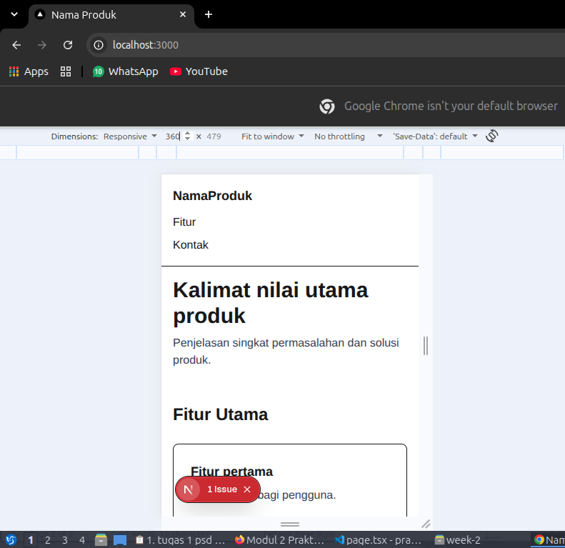
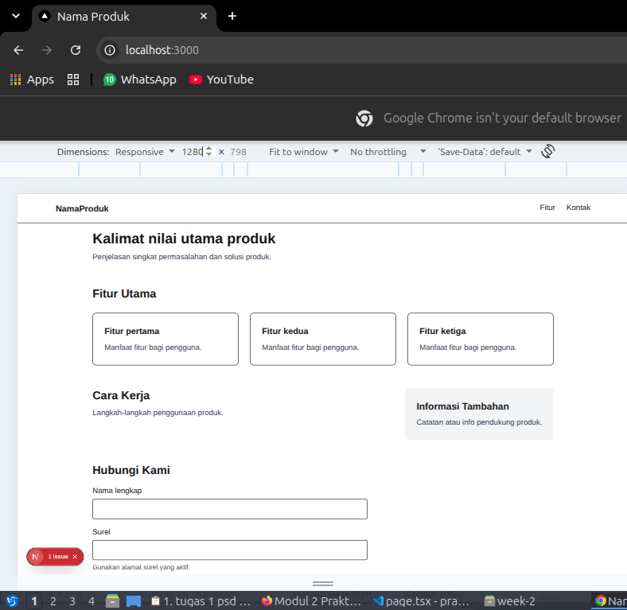
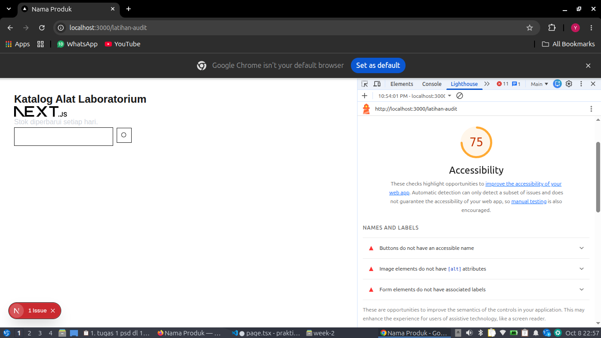
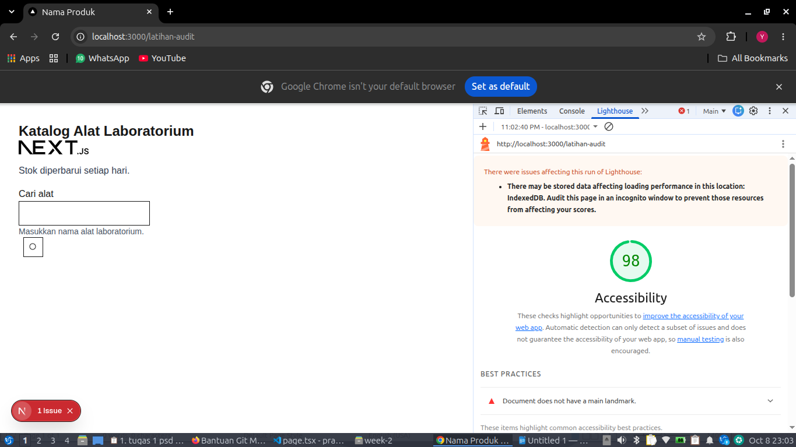
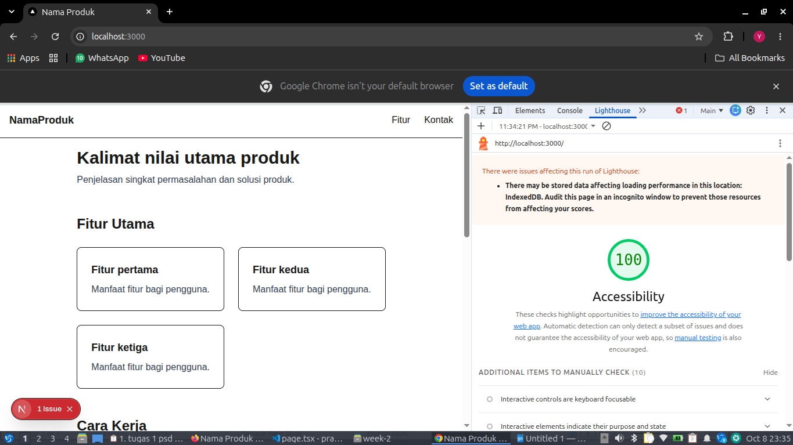

# Dokumen Teknis Modul 2 – HTML Semantik, Tailwind CSS, dan Aksesibilitas

Nama/NIM : Yusuf Rizky Nugroho / 105224012
Repositori : https://github.com/yusufrn1/praktikum_web

## 1. Struktur Semantik

Halaman utama produk Week 2 berada pada `week-2/code/produk-week2/app/page.tsx`. Struktur halaman disusun menggunakan elemen semantik HTML, bukan `
` tanpa makna, sehingga setiap bagian halaman memiliki peran landmark yang jelas bagi pembaca layar dan mesin pencari.

Elemen semantik yang digunakan:

- `<header className="border-b">` — kepala halaman, dipetakan ke landmark `banner`.
- `<nav aria-label="Navigasi utama">` — kumpulan tautan navigasi, dipetakan ke landmark `navigation`.
- `<main id="konten" className="mx-auto max-w-6xl p-4">` — konten utama halaman, dipetakan ke landmark `main`. Hanya ada satu `<main>` di halaman ini.
- `<section aria-labelledby="judul-utama">` — bagian hero yang memuat nilai utama produk.
- `<section id="fitur" aria-labelledby="judul-fitur">` — daftar fitur utama, berisi tiga `<article>` kartu fitur.
- `<section aria-labelledby="judul-cara">` — bagian "Cara Kerja".
- `<aside aria-label="Informasi tambahan">` — konten pendukung di samping "Cara Kerja", dipetakan ke landmark `complementary`.
- `<section id="kontak" aria-labelledby="judul-kontak">` — bagian formulir kontak.
- `<footer className="border-t">` — kaki halaman, dipetakan ke landmark `contentinfo`.

Hierarki judul:

- `<h1 id="judul-utama">Kalimat nilai utama produk</h1>` — satu-satunya `<h1>` di halaman.
- `<h2>` — "Fitur Utama", "Cara Kerja", "Informasi Tambahan", dan "Hubungi Kami". Setiap section dan aside memiliki judul `<h2>` yang dirujuk oleh `aria-labelledby`.
- `<h3>` — judul tiap kartu fitur.

Hierarki judul runtut dari `<h1>` ke `<h2>` lalu `<h3>` tanpa melompat.

Tautan "Lewati ke konten utama" (`<a href="#konten" className="sr-only focus:not-sr-only focus:p-2">`) ditempatkan di awal halaman. Tautan ini tersembunyi secara visual dengan kelas `sr-only` dan baru tampil saat menerima fokus papan ketik.

## 2. Tata Letak Responsif

Tata letak halaman dibangun dengan pendekatan **mobile-first** Tailwind CSS: kelas tanpa awalan berlaku untuk semua ukuran layar, sedangkan kelas berawalan breakpoint (`sm:`, `md:`, `lg:`) berlaku mulai lebar tersebut ke atas.

Kelas Flexbox, Grid, dan breakpoint yang digunakan:

- **Navigasi** (`<nav>`): `mx-auto flex max-w-6xl flex-col gap-3 p-4 sm:flex-row sm:items-center sm:justify-between`
  - Flexbox untuk tata letak satu dimensi. Di ponsel item bertumpuk; mulai `sm` (640 px) menjadi mendatar.
- **Daftar fitur** (`<ul>`): `mt-6 grid grid-cols-1 gap-6 sm:grid-cols-2 lg:grid-cols-3`
  - Grid untuk tata letak dua dimensi. Jumlah kolom berubah dari 1 (ponsel) → 2 (≥640 px) → 3 (≥1024 px).
- **Konten dan aside**: `mt-12 grid gap-8 lg:grid-cols-[2fr_1fr]`
  - Nilai sembarang `grid-cols-[2fr_1fr]` membuat kolom pertama dua kali lebih lebar dari kolom kedua. Bertumpuk di ponsel, berdampingan mulai `lg` (1024 px).
- **Pembungkus konten**: `mx-auto max-w-6xl p-4` pada `<main>`, membatasi lebar maksimum dan menengahkan konten.

Alasan pemilihan Flexbox vs Grid:

- **Flexbox** untuk tata letak satu dimensi (baris navigasi dan susunan tombol). Cukup dengan `flex`, `justify-between`, `items-center`.
- **Grid** untuk tata letak dua dimensi (kumpulan kartu fitur, pembagian konten–aside). Grid memudahkan penentuan jumlah kolom sekaligus lebar kolom.

Tangkapan layar pada lebar 360 px dan 1280 px:

Pada lebar 360 px, kartu fitur bertumpuk dalam satu kolom, navigasi bertumpuk, dan tidak muncul gulir horizontal. Pada lebar 1280 px, kartu fitur tampil dalam tiga kolom dan bagian "Informasi Tambahan" berada di samping "Cara Kerja". Lebar 768 px juga diuji dan tidak memunculkan gulir horizontal, dengan kartu fitur dalam dua kolom.

## 3. Audit Aksesibilitas

Audit dilakukan dengan panel Lighthouse pada Chrome DevTools, mode Navigation, perangkat Mobile, kategori Accessibility.

Tabel skor Lighthouse:

| Halaman | Sebelum perbaikan | Sesudah perbaikan |
|---|---|---|
| /latihan-audit | 75 | 98 |
| / (produk-week2) | 100 | 100 |

Skor sebelum perbaikan pada halaman latihan:

Skor sesudah perbaikan pada halaman latihan:

Skor halaman utama produk:

Halaman `app/latihan-audit/page.tsx` dibuat khusus untuk latihan audit, kemudian dihapus setelah hasil audit dicatat karena bukan bagian dari produk.

Daftar audit yang gagal pada halaman latihan dan perbaikannya:

| Audit yang gagal | Penyebab | Perbaikan |
|---|---|---|
| Image elements do not have `[alt]` attributes | `` tanpa atribut `alt` | Ditambahkan `alt="Logo Next.js"` |
| Background and foreground colors do not have a sufficient contrast ratio | Teks memakai `text-gray-300` di atas latar putih sehingga rasio kontras di bawah 4,5:1 | Diganti menjadi `text-gray-700` |
| Form elements do not have associated labels | `<input type="search">` tanpa `<label>` | Ditambahkan `<label htmlFor="cari">Cari alat</label>` dan `aria-describedby="cari-bantuan"` |
| Buttons do not have an accessible name | Tombol ikon hanya berisi SVG tanpa teks | Ditambahkan `aria-label="Cari"` pada tombol dan `aria-hidden="true"` pada ikon SVG |
| Heading tidak runtut (temuan manual) | Judul halaman ditulis dengan `
` | Diganti menjadi `<h1>` |
| Document does not have a main landmark (best practice) | Halaman latihan tidak memiliki elemen `<main>` | Halaman latihan sengaja tidak ditambahkan `<main>` karena hanya untuk latihan; halaman utama produk sudah memiliki `<main>` |

Lighthouse juga menampilkan catatan bahwa ada data tersimpan (IndexedDB) yang berpotensi memengaruhi skor performa. Audit disarankan dijalankan pada jendela Incognito untuk menghindari pengaruh tersebut.

Selain audit otomatis, dilakukan pemeriksaan manual dengan papan ketik:

- Urutan fokus mengikuti urutan visual: skip link → tautan navigasi → tombol CTA hero → kartu fitur → kolom formulir → tombol Kirim → tautan footer.
- Garis fokus selalu terlihat. Kolom formulir memakai kelas `focus-visible:outline-2 focus-visible:outline-offset-2 focus-visible:outline-blue-700`.
- Tombol Spasi memilih radio "Peran", tombol Enter mengirim formulir.
- Placeholder tidak digunakan sebagai pengganti label, karena teksnya hilang saat pengguna mulai mengetik dan sering berkontras rendah.

## 4. Kendala dan Penyelesaian

1. **Gulir horizontal pada lebar 360 px.** Awalnya kartu fitur dipaksa tiga kolom dengan `grid-cols-3` tanpa awalan breakpoint. Diselesaikan dengan pendekatan mobile-first: `grid-cols-1 sm:grid-cols-2 lg:grid-cols-3`.

2. **Kelas Tailwind tidak berpengaruh.** Penyebabnya adalah nama kelas yang disusun dari potongan string, sedangkan Tailwind hanya membuat kelas yang tertulis utuh di kode sumber. Diselesaikan dengan menulis nama kelas lengkap.

3. **Atribut HTML di dalam JSX.** Sempat muncul peringatan `Invalid DOM property class` dan `for`. Diselesaikan dengan mengganti `class` menjadi `className` dan `for` menjadi `htmlFor`.

4. **Nested Git repository.** Folder `week-2/code/` hasil salinan ternyata membawa folder `.git` sendiri, sehingga `git add week-2/` gagal dengan pesan `does not have a commit checked out`. Diselesaikan dengan menghapus `.git` bersarang (`rm -rf week-2/code/.git`).

5. **Runtime error pada `/latihan-audit`.** Setelah folder dihapus, Next.js masih mencoba render halaman tersebut karena cache `.next/` masih menyimpan build lama. Diselesaikan dengan menghapus cache (`rm -rf .next`) dan menjalankan ulang dev server.

6. **Skor Lighthouse berubah-ubah.** Penyebabnya adalah ekstensi peramban yang aktif dan data IndexedDB yang tersimpan. Audit kemudian dijalankan pada jendela Incognito agar hasil konsisten.

## 5. Catatan Pemanfaatan AI

Alat yang digunakan: DeepSeek (asisten percakapan) dan GitHub Copilot (autocomplete di VS Code).

Perintah utama yang diberikan:

- "Jelaskan perbedaan Flexbox dan Grid pada Tailwind CSS beserta contoh kelasnya."
- "Bantu susun kerangka dokumen teknis Modul 2 sesuai Bagian H modul."
- "Periksa kode `app/page.tsx` dan tunjukkan potensi masalah aksesibilitas."
- "Bantu perbaiki `app/latihan-audit/page.tsx` agar lolos audit Lighthouse."

Bagian yang dibantu AI:

- Penyusunan kerangka dokumen teknis ini.
- Penjelasan alasan pemilihan Flexbox vs Grid.
- Pemeriksaan awal struktur semantik dan penamaan kelas Tailwind.
- Perbaikan halaman latihan audit agar memenuhi kriteria WCAG 2.2.

Cara verifikasi:

- Setiap saran kode dijalankan di `npm run dev` dan diperiksa tampilannya pada 360 px, 768 px, dan 1280 px.
- Audit Lighthouse dijalankan ulang setelah setiap perubahan untuk memastikan skor naik (halaman latihan 75 → 98, halaman utama 100).
- Pemeriksaan manual dengan tombol Tab dilakukan untuk memastikan urutan fokus dan garis fokus tetap benar.
- Kelas Tailwind yang disarankan AI dicek keberadaannya melalui ekstensi Tailwind CSS IntelliSense sebelum dipakai.