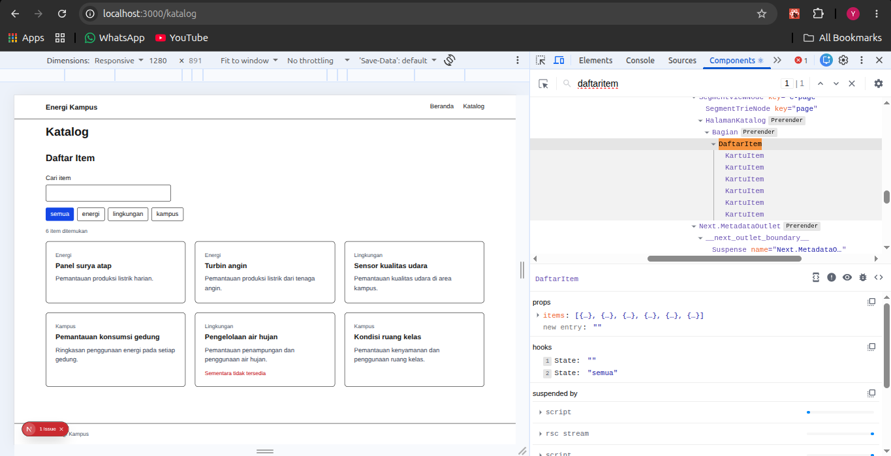
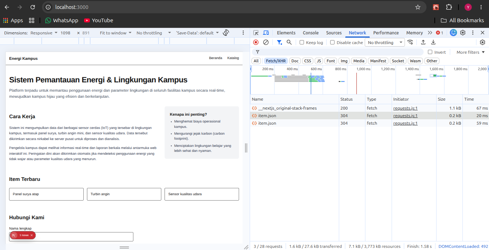

# Dokumen Teknis Modul 3 — TypeScript dan Komponen React

Nama/NIM: [Yusuf Rizky Nugroho/105224012]

Repositori: [Isi URL repositori GitHub]

## 1. Tipe Data Produk

Tipe data produk didefinisikan pada `lib/tipe.ts`:

```ts
export type Kategori = "energi" | "lingkungan" | "kampus";

export interface Item {
  id: number;
  judul: string;
  kategori: Kategori;
  deskripsi: string;
  tersedia: boolean;
  gambar?: string;
}
```

`Kategori` menggunakan union literal agar nilai kategori dibatasi pada tiga pilihan yang dipakai filter. `gambar` bersifat opsional karena item dapat ditampilkan tanpa gambar. `lib/data.ts` menyediakan enam item bertipe `Item`; kategori energi, lingkungan, dan kampus semuanya memiliki contoh data. Fixture `public/data/item.json` berisi data yang sama untuk kebutuhan Fetch API.

## 2. Struktur Komponen

Pohon komponen akhir:

```text
RootLayout (Server Component, app/layout.tsx)
├── SiteHeader (namaProduk, tautan)
├── Beranda (Server Component, app/page.tsx)
│   ├── Bagian (Cara Kerja)
│   ├── Bagian (Item Terbaru)
│   │   └── ItemTerbaru (Client Component, Fetch API)
│   └── Bagian (Hubungi Kami)
├── HalamanKatalog (Server Component, app/katalog/page.tsx)
│   └── Bagian (Daftar Item)
│       └── DaftarItem (Client Component, pencarian dan filter)
│           └── KartuItem (props item: Item)
└── SiteFooter (namaProduk)
```

| Komponen | Props | Penggunaan |
| --- | --- | --- |
| `SiteHeader` | `namaProduk: string`, `tautan: Tautan[]` | `app/layout.tsx` |
| `SiteFooter` | `namaProduk: string` | `app/layout.tsx` |
| `Bagian` | `id: string`, `judul: string`, `children: React.ReactNode` | Beranda dan katalog |
| `DaftarItem` | `items: Item[]` | `app/katalog/page.tsx` |
| `KartuItem` | `item: Item` | Setiap hasil pada `DaftarItem` |
| `ItemTerbaru` | Tidak ada props | `app/page.tsx` |

`SiteHeader`, `SiteFooter`, layout, dan halaman tidak memerlukan interaktivitas sehingga tetap menjadi Server Component. `DaftarItem` dan `ItemTerbaru` memakai state/effect sehingga menjadi Client Component. `KartuItem` tidak memakai hook sendiri, tetapi diimpor oleh `DaftarItem` dan ikut dalam client module graph. `Bagian` digunakan untuk membungkus section dan menerima konten melalui `children`.

## 3. State dan Interaksi

`DaftarItem` mengelola state `kataKunci` dan `filter`. Input pencarian adalah controlled input yang memperbarui `kataKunci` melalui `onChange`. Tombol filter memperbarui `filter` dan menandai pilihan aktif dengan `aria-pressed`. Hasil dihitung dari props dan state saat render, bukan disimpan sebagai state tambahan. Daftar memakai `item.id` sebagai key stabil dan menampilkan pesan ketika hasil kosong.

Tangkapan layar React Developer Tools, tab Components, yang menunjukkan props `items` dan state `kataKunci` serta `filter`:



## 4. Pengambilan Data

`ItemTerbaru` mengambil `/data/item.json` di dalam `useEffect`, memeriksa `res.ok`, lalu menampilkan tiga item pertama. Status memuat, berhasil, dan gagal ditangani terpisah. Cleanup effect mencegah pembaruan state setelah komponen dilepas. Komponen katalog tidak mengambil JSON: halaman katalog meneruskan `daftarItem` bertipe `Item[]` ke `DaftarItem`.

Tangkapan layar panel Network untuk permintaan `item.json`:



Hasil uji kondisi:

- Memuat: TODO, aktifkan throttling jaringan dan catat tampilan yang muncul.
- Berhasil: TODO, pastikan tiga item tampil dan permintaan `item.json` berstatus sukses.
- Gagal: TODO, uji respons 404 dan catat pesan galat yang tampil.

## 5. Verifikasi

Perintah berikut telah dijalankan pada proyek:

```text
npx tsc --noEmit
Selesai tanpa galat.

npm run lint
Selesai tanpa galat.

npm run build
Build berhasil; halaman /, /katalog, dan /_not-found berhasil diprerender.
```

## 6. Kendala dan Penyelesaian

- Data awal berjumlah lima item dan seluruhnya berkategori energi. Ditambahkan item keenam dan contoh kategori lingkungan serta kampus agar seluruh pilihan filter dapat diuji.
- Katalog awal memuat JSON melalui Client Component, sedangkan instruksi modul menetapkan katalog memakai data tiruan bertipe dan Fetch API pada bagian item terbaru di beranda. Alur tersebut sudah disesuaikan.
- Berkas footer awal berisi salinan navigasi header. Footer diubah menjadi komponen bertipe dengan prop `namaProduk`.
- `components/DaftarItemJson.tsx` masih ada tetapi tidak lagi dipakai oleh route mana pun; katalog memakai `DaftarItem` dengan data bertipe dari server.
- Next.js memberi peringatan bahwa workspace memiliki lockfile pada folder `week-3` dan `produk-week-3`. Peringatan ini tidak menggagalkan build.
- `npm install` melaporkan lima advisori berkeparahan tinggi. Detailnya belum diaudit dan tidak ada perbaikan dependensi otomatis yang diterapkan.

## 7. Catatan Pemanfaatan AI

Alat: GitHub Copilot Chat.

Pemanfaatan: membandingkan implementasi proyek dengan Modul 3, memperbaiki alur komponen/data yang belum sesuai, menambah contoh data, dan menyusun draf dokumen ini. Verifikasi yang dilakukan: `npx tsc --noEmit`, `npm run lint`, dan `npm run build`. Interaksi pencarian/filter, throttling untuk status memuat, uji 404, serta tangkapan layar React Developer Tools dan Network tetap perlu dilakukan dan dilengkapi secara manual sebelum dokumen dikumpulkan.
